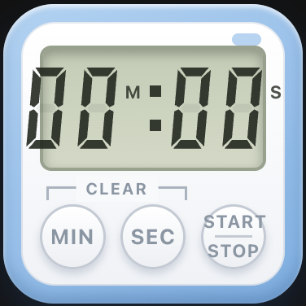
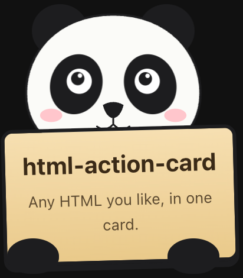
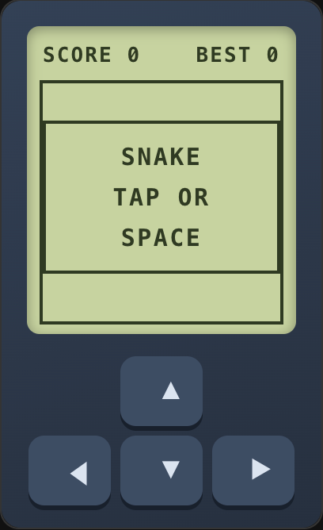

# HTML Action Card

[](https://hacs.xyz)
[](https://github.com/davidrot/ha-html-action-card/releases)
[](https://github.com/davidrot/ha-html-action-card/actions/workflows/ci.yml)
[](LICENSE)


A Home Assistant Lovelace card for **plain HTML and CSS**. Add states with `{{ }}`, conditions with `data-show-if`, and Home Assistant actions with `data-event` + `data-action`. Need more? Drop in a `<script>`.

> ⚠️ Alpha. Syntax may change before 1.0. Your HTML and scripts run unfiltered: only use markup you understand. The editor's security rating tells you what a card can do.

<p align="center">
  <a href="examples/kitchen-timer.html"></a>
  <a href="examples/panda.html"></a>
  <a href="examples/snake.html"></a>
</p>

## Contents

- [Why](#why)
- [Installation](#installation)
- [Quick start](#quick-start)
- [The four building blocks](#the-four-building-blocks)
- [Scripts](#scripts)
- [Security rating](#security-rating)
- [Examples](#examples)
- [Use with AI](#use-with-ai)
- [Roadmap](#roadmap)
- [Development](#development)
- [License](#license)

## Why

- **Design freedom.** Anything HTML and CSS can do, not only what a card author put into the options.
- **One card instead of ten.** Joystick, remote control, room tile, status bar: one card, one syntax.
- **AI writes HTML very well.** Describe the card in a sentence, paste the result ([prompt](docs/LLM-PROMPT.md)).
- **Web knowledge is enough.** If you know HTML and CSS there is nothing new to learn.
- **No JavaScript for the normal case.** States, conditions and actions are four small building blocks. Scripts are possible, not required.
- **Transparency instead of bans.** Nothing is blocked. A built-in security rating (🟢 🟡 🔴) tells you what your markup can do, so you decide.
- **Prototype without a build.** Try a design in minutes before you write a real card.

When you do not need it: when a standard card does the job. You maintain your own markup, and it only follows your theme if you use the Home Assistant color variables (`var(--primary-color)` …).

The whole card is one piece of HTML in `content`: markup, a `<style>` block, a `<script>` block if you want one. It is rendered inside a Shadow DOM, so your CSS stays inside the card.

## Installation

**HACS (custom repository):**
1. HACS → ⋮ → *Custom repositories*.
2. Repository: `https://github.com/davidrot/ha-html-action-card`, type: *Dashboard* (called *Lovelace* in older HACS versions).
3. Install **HTML Action Card**, then reload the browser.

**Manual:** download `html-action-card.js` from the [latest release](https://github.com/davidrot/ha-html-action-card/releases), copy it to `config/www/`, and add `/local/html-action-card.js` as a dashboard resource (type *JavaScript module*).

Then add a card: search for **HTML Action Card** in the card picker, or use YAML with `type: custom:html-action-card`.

## Quick start

```yaml
type: custom:html-action-card
content: |
  <style>
    .lamp { width: 24px; height: 24px; border-radius: 50%; background: gray; }
    .lamp.on { background: gold; }
  </style>
  <div class="lamp {{ light.kitchen.state }}"></div>
  <button data-event="tap" data-action="light.toggle" data-entity="light.kitchen">
    Kitchen: {{ light.kitchen.state }}
  </button>
  <p data-show-if="sensor.living_room_temp.state > 25">It's hot: {{ sensor.living_room_temp.state }}°C</p>
```

## The four building blocks

| Block | Job | Example |
|---|---|---|
| `data-event` | **When** (HTML side) | `tap` (default), `hold`, `dbltap`, `press`, `release` |
| `data-action` | **What** (Home Assistant side) | `light.turn_on`, `toggle`, `more-info`, `navigate`, `url` |
| `data-show-if` | **Visibility** by state | `data-show-if="light.kitchen.state == on"` |
| `{{ }}` | **Insert a value** | `{{ sensor.temp.state }}`, `{{ light.kitchen.attributes.brightness }}` |

Action helpers: `data-entity`, `data-data='{"brightness_pct":50}'`, `data-path` (navigate), `data-url` (+ `data-target`), `data-confirm="Sure?"`, `data-repeat="150"` (ms, with `press`), `data-delay="800"` (ms, with `hold`, default 500).

Elements with an action get `is-pending` while it runs, `is-error` if it fails (plus a Home Assistant toast), and `is-unavailable` (action blocked) while their `data-entity` is unavailable. `press` and `hold` set `touch-action: none` by default so touch scrolling does not cancel them.

Entities are written like Home Assistant's state objects, always with the property you want: `{{ light.kitchen.state }}`, `{{ light.kitchen.attributes.brightness }}`, `{{ light.kitchen.last_changed }}`. There is no default: a bare `{{ light.kitchen }}` renders nothing, and so does anything that cannot be resolved. The Jinja form `states.light.kitchen.state` is accepted too. Works in text and attribute values (`class="lamp {{ light.kitchen.state }}"`).

`{{ }}` and `data-show-if` share one expression language: comparisons, `&& || !`, arithmetic, `? :`, parentheses. Examples: `data-show-if="light.a.state == on && sensor.t.state > 20"`, `{{ sensor.t.state > 25 }}` (renders `true`/`false`), `{{ sensor.t.state * 2 }}`. Bare words like `on` are strings; numeric states compare as numbers. You can call functions: `{{ Math.round(sensor.t.state) }}`, or your own via `card.expose({ calc })` in a script: `{{ calc(1+2) > 3 }}`.

`now()` is reactive (ticks every second by default, `refresh_interval` to change), and `relative(date)` gives "5 min ago": `{{ relative(sensor.x.last_changed) }}`.

**HTML added later works too.** Elements your scripts insert with `innerHTML`/`appendChild` are picked up automatically (`{{ }}`, `data-show-if`, `data-action`).

**Updates are automatic.** The card tracks which entities each expression reads and re-evaluates only those when an entity changes; the DOM is touched only if the result changed. You never call render yourself.

Elements get `is-unavailable` and `is-error` classes when relevant. Missing entities never crash the card.

## Scripts

```html
<button id="up">Up</button>
<script>
  const b = document.getElementById('up');
  b.addEventListener('click',    () => card.call('button', 'press', { entity_id: 'button.cam_up' }));
  b.addEventListener('dblclick', () => card.navigate('/lovelace/cameras'));
  // re-runs automatically whenever an entity read inside changes
  card.effect(() => { b.textContent = card.state('light.kitchen') === 'on' ? 'Turn off' : 'Turn on'; });
</script>
```

Your HTML and JavaScript run **as written**, like on any web page. Because the card uses Shadow DOM, scripts receive a `document` shim that searches inside the card, plus `card` (`call`, `action`, `navigate`, `moreInfo`, `toggle`, `state`, `attr`, `effect`, `expose`, `onEntity`, `on`, `$`, `cleanup`) and `hass`. Scripts run once per render, before the first state is evaluated (so `card.expose` functions work in `{{ }}`). Multiple events on one element? Use a script.

Good to know:
- `hass` is live in classic scripts. `type="module"` scripts get `card` and `document` too (`hass` is a snapshot there, use `card.hass`).
- `<script src="https://…">` loads a real script tag into the page (CDN libraries like Chart.js); `type="module"` works too.
- Scripts run again whenever the card is rendered or re-attached by Home Assistant. Nothing piles up: `setTimeout`/`setInterval`/`requestAnimationFrame`, listeners on `window` and `document`, and Mutation/Resize/Intersection observers are released automatically when the card goes away. Use `card.cleanup(fn)` for anything else (WebSockets, subscriptions).
- `document.body` is the card's content, and `DOMContentLoaded` listeners run right away.
- Each script block is isolated. Share functions through `card.expose` or `window`.
- A failing script is reported in the console and the following scripts still run. Scripts added later with `innerHTML` do not run (browser rule).

## Security rating

Nothing is removed or blocked. The card editor reads your card while you type and shows a rating on top, with the reasons and line numbers:

| | Meaning | Examples |
|---|---|---|
| 🟢 | Plain markup | HTML, CSS, `data-*`, `{{ }}` |
| 🟡 | Worth a look | a `<script>` block, external images/fonts/CSS, a lock, alarm or `shell_command` action without `data-confirm`, `data-repeat` below 100 ms |
| 🔴 | Can run or load foreign code | `<iframe>`, `<script src="https://…">`, `onclick="…"`, `javascript:` URLs, and in scripts or expressions: `eval`, `fetch`, `WebSocket`, cookies, browser storage, the login token |

Grey hints do not change the rating: typos like `data-acton`, a bare `{{ light.kitchen }}`, invalid JSON in `data-data`, unknown entities and services.

The rating reads text; it cannot prove a card is safe. A green card contains none of the things above. Only paste markup you understand, especially from the internet or an AI.

## Examples

Ready to paste into the card editor, in [`examples/`](examples):

- [`kitchen-timer.html`](examples/kitchen-timer.html): a three-button kitchen timer backed by a Timer helper.
- [`camera-control.html`](examples/camera-control.html): the live camera picture is the joystick. Press an edge to move the camera.
- [`panda.html`](examples/panda.html): a panda that holds a sign and follows your cursor, without a card frame.
- [`snake.html`](examples/snake.html): a game in a dashboard card.

Run `npm run dev` and open `/playground/examples.html` to try them against a mock Home Assistant.

## Use with AI

Paste [`docs/LLM-PROMPT.md`](docs/LLM-PROMPT.md) into your assistant, describe the card, paste the result.

## Roadmap

Formatting helpers, entity picker, reusable templates, card-picker suggestions.

## Development

```bash
npm install
npm run dev        # playground with a mock hass, no Home Assistant needed
npm test
npm run build      # dist/html-action-card.js
```

Issues and pull requests are welcome.

## License

MIT
