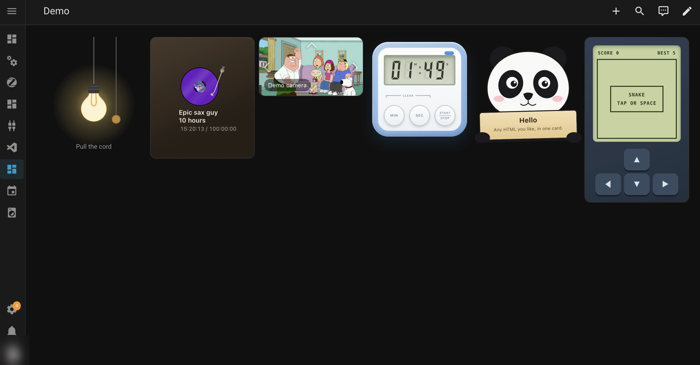
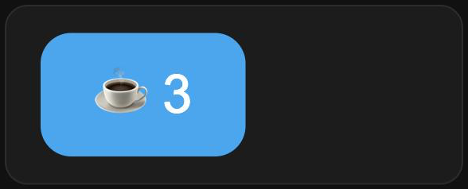
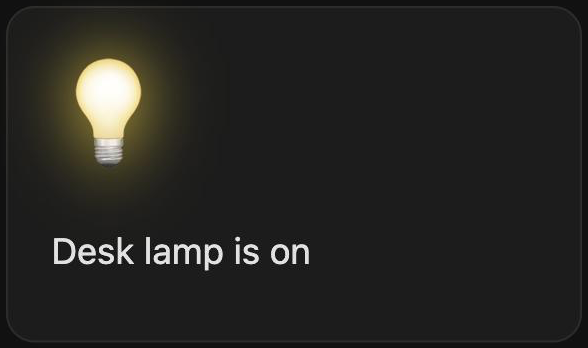
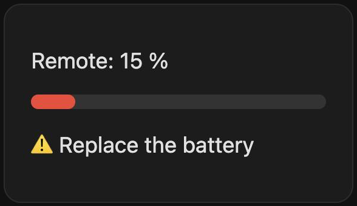
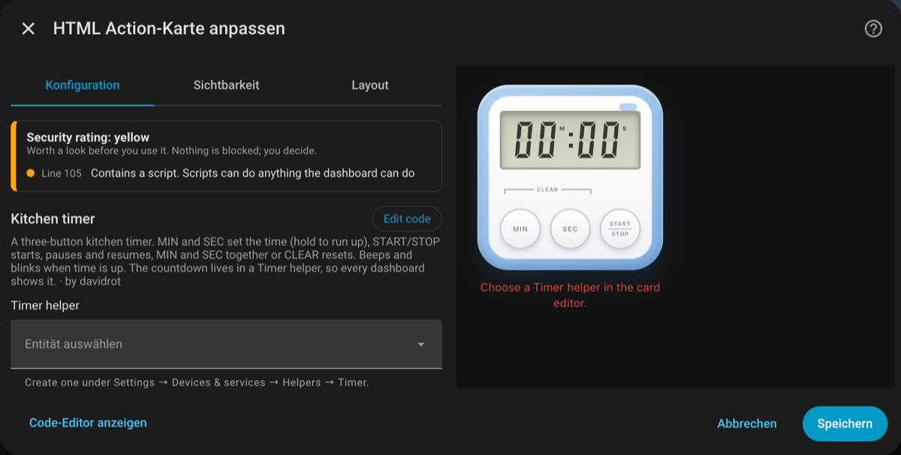
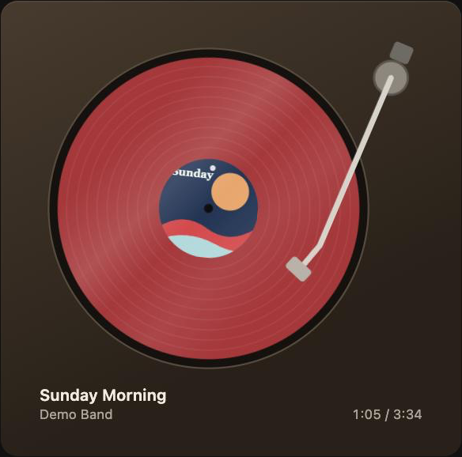
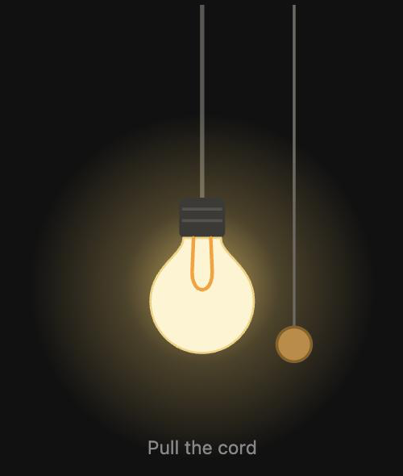
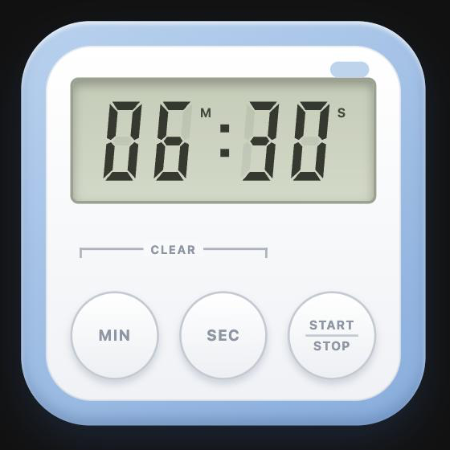

# HTML Action Card

[](https://hacs.xyz)
[](https://github.com/davidrot/ha-html-action-card/releases)
[](https://github.com/davidrot/ha-html-action-card/actions/workflows/ci.yml)
[](LICENSE)


**Build your own Home Assistant dashboard cards in plain HTML and CSS**, with live entity states, tap, hold and press actions, and optional JavaScript. One custom card for every design, instead of a new custom card for every button.

Add states with `{{ }}`, conditions with `data-show-if`, and Home Assistant actions with `data-event` + `data-action`. Need more? Drop in a `<script>`. Works with cards written by hand, copied from the [showroom](showroom), or generated by an AI assistant.

<p align="center">
  <a href="docs/media/demo.mp4"></a>
</p>

<p align="center"><a href="docs/media/demo.mp4">▶ Watch the demo (1:19)</a>: the cards in Home Assistant, adding one, picking its entities in the form, the security rating.</p>

<p align="center">🌐 <a href="https://davidrot.github.io/ha-html-action-card/">Project website</a> · 🖼️ <a href="showroom">Showroom</a> · 🤖 <a href="docs/LLM-PROMPT.md">Prompt for AI assistants</a></p>

## Contents

- [Quick look](#quick-look)
- [Why](#why)
- [Installation](#installation)
- [Quick start](#quick-start)
- [The four building blocks](#the-four-building-blocks)
- [Scripts](#scripts)
- [Inputs](#inputs)
- [State](#state)
- [Security rating](#security-rating)
- [Showroom](#showroom)
  - [Turntable](#turntable)
  - [Pull-cord lamp](#pull-cord-lamp)
  - [Kitchen timer](#kitchen-timer)
  - [Camera control](#camera-control)
  - [Panda](#panda)
  - [Snake](#snake)
- [Use with AI](#use-with-ai)
- [FAQ](#faq)
- [Roadmap](#roadmap)
- [Development](#development)
- [License](#license)

## Quick look

Three small cards, each a few lines of HTML. The picture is what you get on the dashboard.

### A counter you tap



```html
<style>
  button { font-size: 28px; padding: 14px 28px; border: 0; border-radius: 16px;
           background: var(--primary-color); color: white; cursor: pointer; }
</style>
<button data-action="counter.increment" data-entity="counter.coffee">
  ☕ {{ counter.coffee.state }}
</button>
```

### A lamp that shows its state



```html
<style>
  .bulb { font-size: 48px; cursor: pointer; filter: grayscale(1) opacity(.4); }
  .bulb.on { filter: drop-shadow(0 0 14px gold); }
</style>
<div class="bulb {{ light.desk.state }}"
     data-action="toggle" data-entity="light.desk">💡</div>
<p>Desk lamp is {{ light.desk.state }}</p>
```

### A battery bar with a warning



```html
<style>
  .bar { height: 10px; border-radius: 5px; background: #333; }
  .fill { height: 100%; border-radius: 5px; background: #4caf50; }
  .fill.low { background: #f44336; }
</style>
<p>Remote: {{ sensor.remote_battery.state }} %</p>
<div class="bar">
  <div class="fill {{ sensor.remote_battery.state < 20 ? 'low' : '' }}"
       style="width: {{ sensor.remote_battery.state }}%"></div>
</div>
<p data-show-if="sensor.remote_battery.state < 20">⚠️ Replace the battery</p>
```

## Why

- **Design freedom.** Anything HTML and CSS can do, not only what a card author put into the options.
- **One card instead of ten.** Joystick, remote control, room tile, status bar: one card, one syntax.
- **AI writes HTML very well.** Describe the card in a sentence, paste the result ([prompt](docs/LLM-PROMPT.md)).
- **Web knowledge is enough.** If you know HTML and CSS there is nothing new to learn.
- **No JavaScript for the normal case.** States, conditions and actions are four small building blocks. Scripts are possible, not required.
- **Transparency instead of bans.** Nothing is blocked. A built-in security rating (🟢 🟡 🔴) tells you what your markup can do, so you decide.
- **Prototype without a build.** Try a design in minutes before you write a real card.

When you do not need it: when a standard card does the job. You maintain your own markup, and it only follows your theme if you use the Home Assistant color variables (`var(--primary-color)` …).

The whole card is one piece of HTML in `content`: markup, a `<style>` block, a `<script>` block if you want one. It is rendered inside a Shadow DOM, so your CSS stays inside the card.

## Installation

[](https://my.home-assistant.io/redirect/hacs_repository/?owner=davidrot&repository=ha-html-action-card&category=plugin)

**HACS (custom repository):**
1. HACS → ⋮ → *Custom repositories*.
2. Repository: `https://github.com/davidrot/ha-html-action-card`, type: *Dashboard* (called *Lovelace* in older HACS versions).
3. Install **HTML Action Card**, then reload the browser.

**Manual:** download `html-action-card.js` from the [latest release](https://github.com/davidrot/ha-html-action-card/releases), copy it to `config/www/`, and add `/local/html-action-card.js` as a dashboard resource (type *JavaScript module*).

Then add a card: search for **HTML Action Card** in the card picker, or use YAML with `type: custom:html-action-card`.

## Quick start

```yaml
type: custom:html-action-card
content: |
  <style>
    .lamp { width: 24px; height: 24px; border-radius: 50%; background: gray; }
    .lamp.on { background: gold; }
  </style>
  <div class="lamp {{ light.kitchen.state }}"></div>
  <button data-event="tap" data-action="light.toggle" data-entity="light.kitchen">
    Kitchen: {{ light.kitchen.state }}
  </button>
  <p data-show-if="sensor.living_room_temp.state > 25">It's hot: {{ sensor.living_room_temp.state }}°C</p>
```

## The four building blocks

| Block | Job | Example |
|---|---|---|
| `data-event` | **When** (HTML side) | `tap` (default), `hold`, `dbltap`, `press`, `release` |
| `data-action` | **What** (Home Assistant side) | `light.turn_on`, `toggle`, `more-info`, `navigate`, `url` |
| `data-show-if` | **Visibility** by state | `data-show-if="light.kitchen.state == on"` |
| `{{ }}` | **Insert a value** | `{{ sensor.temp.state }}`, `{{ light.kitchen.attributes.brightness }}` |

Action helpers: `data-entity`, `data-data='{"brightness_pct":50}'`, `data-path` (navigate), `data-url` (+ `data-target`), `data-confirm="Sure?"`, `data-repeat="150"` (ms, with `press`), `data-delay="800"` (ms, with `hold`, default 500).

Elements with an action get `is-pending` while it runs, `is-error` if it fails (plus a Home Assistant toast), and `is-unavailable` (action blocked) while their `data-entity` is unavailable. `press` and `hold` set `touch-action: none` by default so touch scrolling does not cancel them.

Entities are written like Home Assistant's state objects, always with the property you want: `{{ light.kitchen.state }}`, `{{ light.kitchen.attributes.brightness }}`, `{{ light.kitchen.last_changed }}`. There is no default: a bare `{{ light.kitchen }}` renders nothing, and so does anything that cannot be resolved. The Jinja form `states.light.kitchen.state` is accepted too. Works in text and attribute values (`class="lamp {{ light.kitchen.state }}"`).

`{{ }}` and `data-show-if` share one expression language: comparisons, `&& || !`, arithmetic, `? :`, parentheses. Examples: `data-show-if="light.a.state == on && sensor.t.state > 20"`, `{{ sensor.t.state > 25 }}` (renders `true`/`false`), `{{ sensor.t.state * 2 }}`. Bare words like `on` are strings; numeric states compare as numbers. You can call functions: `{{ Math.round(sensor.t.state) }}`, or your own via `card.expose({ calc })` in a script: `{{ calc(1+2) > 3 }}`.

`now()` is reactive (ticks every second by default, `refresh_interval` to change), and `relative(date)` gives "5 min ago": `{{ relative(sensor.x.last_changed) }}`.

**HTML added later works too.** Elements your scripts insert with `innerHTML`/`appendChild` are picked up automatically (`{{ }}`, `data-show-if`, `data-action`).

**Updates are automatic.** The card tracks which entities each expression reads and re-evaluates only those when an entity changes; the DOM is touched only if the result changed. You never call render yourself.

Elements get `is-unavailable` and `is-error` classes when relevant. Missing entities never crash the card.

## Scripts

```html
<button id="up">Up</button>
<script>
  const b = document.getElementById('up');
  b.addEventListener('click',    () => card.call('button', 'press', { entity_id: 'button.cam_up' }));
  b.addEventListener('dblclick', () => card.navigate('/lovelace/cameras'));
  // re-runs automatically whenever an entity read inside changes
  card.effect(() => { b.textContent = card.state('light.kitchen') === 'on' ? 'Turn off' : 'Turn on'; });
</script>
```

Your HTML and JavaScript run **as written**, like on any web page. Because the card uses Shadow DOM, scripts receive a `document` shim that searches inside the card, plus `card` (`call`, `action`, `navigate`, `moreInfo`, `toggle`, `state`, `attr`, `effect`, `expose`, `onEntity`, `on`, `$`, `cleanup`, `input`, `store`) and `hass`. Scripts run once per render, before the first state is evaluated (so `card.expose` functions work in `{{ }}`). Multiple events on one element? Use a script.

Good to know:
- `hass` is live in classic scripts. `type="module"` scripts get `card` and `document` too (`hass` is a snapshot there, use `card.hass`).
- `<script src="https://…">` loads a real script tag into the page (CDN libraries like Chart.js); `type="module"` works too.
- Scripts run again whenever the card is rendered or re-attached by Home Assistant. Nothing piles up: `setTimeout`/`setInterval`/`requestAnimationFrame`, listeners on `window` and `document`, and Mutation/Resize/Intersection observers are released automatically when the card goes away. Use `card.cleanup(fn)` for anything else (WebSockets, subscriptions).
- `document.body` is the card's content, and `DOMContentLoaded` listeners run right away.
- Each script block is isolated. Share functions through `card.expose` or `window`.
- A failing script is reported in the console and the following scripts still run. Scripts added later with `innerHTML` do not run (browser rule).

## Inputs

A card can declare the entities and settings it needs in a frontmatter block at the top, like a Home Assistant blueprint. The card editor then shows a form instead of code: pick your entities, done. **Edit code** switches to the full content.



```html
---
name: Lamp switch
description: One button for one light.
author: you
inputs:
  lamp:
    name: Lamp
    selector:
      entity:
        domain: light
  label:
    name: Label
    default: Lamp
    selector:
      text: {}
---
<button data-action="toggle" data-entity="{{ input.lamp }}">
  {{ input.label }}: {{ input.lamp.state }}
</button>
```

- Selectors are the same as in blueprints (`entity`, `number`, `text`, `boolean`, …).
- `{{ input.lamp }}` is the picked value. For an entity, `{{ input.lamp.state }}` and `{{ input.lamp.attributes.brightness }}` read that entity.
- Scripts read inputs with `card.input('lamp')`.
- The picked values are stored next to the content (`inputs:` in the card config), so a newer version of a card replaces the content without losing them.

## State

Every card can keep information, also across a page reload. Where it lives is up to the card:

- **While the card is shown:** plain variables in a `<script>`.
- **Across a reload, in this browser:** `card.store`.

  ```js
  const best = card.store.get('best', 0);
  card.store.set('best', best + 1);
  ```

  Values are stored as JSON in the browser and shared by all cards with the same frontmatter `name`.
- **Across devices and users:** a Home Assistant helper (`input_number`, `input_text`, `input_boolean`, …), read with `{{ }}` or `card.state()` and written with an action such as `input_number.set_value`. Automations can use it too.

The [Snake](#snake) card uses both: its best score survives a reload with `card.store`, and is shared through a helper if you pick one.

## Security rating

Nothing is removed or blocked. The card editor reads your card while you type and shows a rating on top, with the reasons and line numbers:

| | Meaning | Examples |
|---|---|---|
| 🟢 | Plain markup | HTML, CSS, `data-*`, `{{ }}` |
| 🟡 | Worth a look | a `<script>` block, external images/fonts/CSS, a lock, alarm or `shell_command` action without `data-confirm`, `data-repeat` below 100 ms |
| 🔴 | Can run or load foreign code | `<iframe>`, `<script src="https://…">`, `onclick="…"`, `javascript:` URLs, and in scripts or expressions: `eval`, `fetch`, `WebSocket`, cookies, browser storage, the login token |

Grey hints do not change the rating: typos like `data-acton`, a bare `{{ light.kitchen }}`, invalid JSON in `data-data`, unknown entities and services.

The rating reads text; it cannot prove a card is safe. A green card contains none of the things above. Only paste markup you understand, especially from the internet or an AI.

## Showroom

Cards built with this card, ready to paste into the card editor. The full gallery is in [`showroom/`](showroom), and you can [add your own](CONTRIBUTING.md#add-a-card-to-the-showroom).

The first two show what sets this card apart: real gestures, live state and animation that no option-based card offers.

### Turntable



A media player as a record player. The cover spins on the label, the vinyl takes on the cover's colour, and the tone arm lowers onto the record while music plays. Tap the record to play or pause, drag the arm to jump within the song. [`showroom/turntable`](showroom/turntable/)

### Pull-cord lamp



Pull the cord to switch a light. The cord springs back, the lamp swings, and the bulb glows with the light's real brightness. [`showroom/pull-cord-lamp`](showroom/pull-cord-lamp/)

### Kitchen timer



A three-button kitchen timer backed by a Timer helper, so every dashboard shows the same countdown. [`showroom/kitchen-timer`](showroom/kitchen-timer/)

### Camera control


The live camera picture is the joystick: press an edge to move the camera. No script. [`showroom/camera-control`](showroom/camera-control/)

### Panda


A panda that holds a sign and follows your cursor, without a card frame. [`showroom/panda`](showroom/panda/)

### Snake


A game in a dashboard card. [`showroom/snake`](showroom/snake/)

Run `npm run dev` and open `/playground/examples.html` to try them against a mock Home Assistant.

## Use with AI

Paste [`docs/LLM-PROMPT.md`](docs/LLM-PROMPT.md) into your assistant, describe the card, paste the result.

## FAQ

### How do I design my own buttons in Home Assistant without button-card or card-mod YAML?
Add an HTML Action Card and write the button in HTML and CSS: `<button data-action="light.toggle" data-entity="light.kitchen">{{ light.kitchen.state }}</button>`. Any look CSS can produce is possible, and the state updates live.

### Can I use HTML, CSS and JavaScript in a Home Assistant dashboard?
Yes, that is what this card is for. The content is rendered as written inside a Shadow DOM, so your CSS stays in the card. A `<script>` block gets a small `card` API to call services, read states and react to changes. See [Scripts](#scripts).

### How do I build a joystick or touch control for a PTZ camera (Tapo, Reolink, …)?
Use the [camera control](showroom/camera-control/) card from the showroom: the live picture is the joystick, and pressing an edge moves the camera. For a separate joystick, give each arrow `data-event="press" data-repeat="300" data-action="button.press"` with the camera's move button as `data-entity`.

### How do I let ChatGPT, Claude or another AI create a Home Assistant card?
Paste [`docs/LLM-PROMPT.md`](docs/LLM-PROMPT.md) into the assistant, describe the card you want and paste the result into the card editor. The security rating then shows what the generated code does.

### Is it safe to paste HTML or scripts from the internet?
Nothing is blocked, but the editor rates every card green, yellow or red and lists the reasons: scripts, external resources, network access, sensitive actions without confirmation and more. Read the [Security rating](#security-rating) section.

### Can a card remember things after a page reload?
Yes. `card.store` keeps values in the browser, and Home Assistant helpers share them across devices. See [State](#state).

### How do I show something only when a sensor has a certain value?
Add `data-show-if` to any element, for example `data-show-if="binary_sensor.window.state == on"` or `data-show-if="sensor.temperature.state > 25 && light.fan.state == off"`.

### How is this different from button-card, Mushroom or Bubble Card?
Those are excellent cards with their own options and styles. HTML Action Card has no fixed design: you write the markup, so one card covers a joystick, a media player, a timer or a game. It fits best when you have a specific design in mind or let an AI write it.

## Roadmap

Formatting helpers, importing cards from a link, card-picker suggestions.

## Development

```bash
npm install
npm run dev        # playground with a mock hass, no Home Assistant needed
npm test
npm run build      # dist/html-action-card.js
```

Issues and pull requests are welcome, see [CONTRIBUTING.md](CONTRIBUTING.md).

## License

MIT
