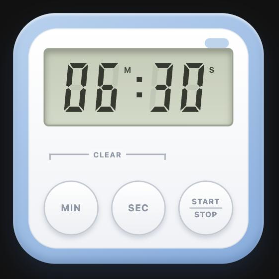
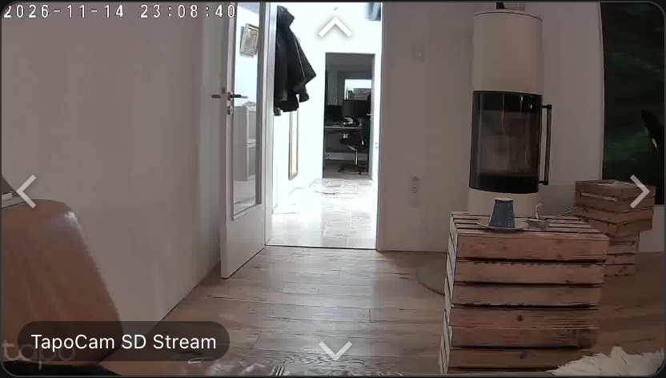
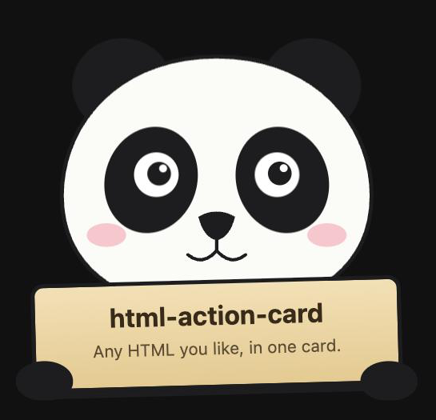
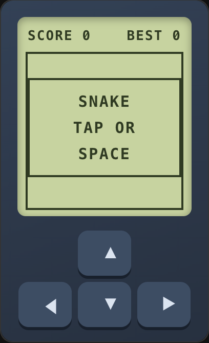

# Showroom

Cards built with HTML Action Card. Open one, paste its `card.html` into the card editor, and pick your entities in the form that appears.

| | Card | Rating | Author |
|---|---|---|---|
|  | **[Kitchen timer](kitchen-timer/)** A three-button kitchen timer with a seven-segment display. MIN and SEC set the time, START/STOP starts, pauses and resumes; it beeps and blinks when time is up. The countdown lives in a Timer helper, so every dashboard shows the same time. | 🟡 yellow | [@davidrot](https://github.com/davidrot) |
|  | **[Camera control](camera-control/)** The live camera picture is the joystick: press the top, bottom, left or right part of the picture to move the camera, keep pressing to keep moving. | 🟢 green | [@davidrot](https://github.com/davidrot) |
|  | **[Panda](panda/)** A panda that holds a sign and follows your cursor. No background and no card frame, so it sits on any dashboard. The sign takes any text and live values. | 🟡 yellow | [@davidrot](https://github.com/davidrot) |
|  | **[Snake](snake/)** A game in a dashboard card, with keyboard, swipe and button controls. Optionally flashes a light on every point and keeps a shared high score in a helper. | 🟡 yellow | [@davidrot](https://github.com/davidrot) |

The rating is the card's [security rating](../README.md#security-rating). It is checked automatically for every card in this folder.

## Add your card

Built something you like? Show it in [Discussions](https://github.com/davidrot/ha-html-action-card/discussions/categories/show-and-tell), or add it here with a pull request. [CONTRIBUTING.md](../CONTRIBUTING.md#add-a-card-to-the-showroom) explains how.
