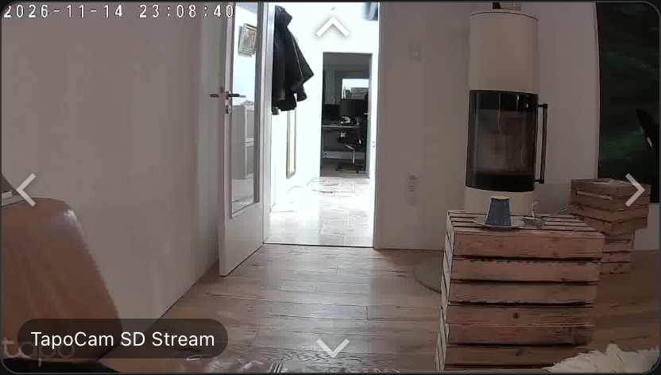

# Camera control

The live camera picture is the joystick: press the top, bottom, left or right part of the picture to move the camera, keep pressing to keep moving.

- **Card:** [card.html](card.html) (paste the whole file into the card editor)
- **Needs:** A camera entity and its four move buttons (for example Tapo)
- **Rating:** green (no script)
- **Author:** [@davidrot](https://github.com/davidrot)
