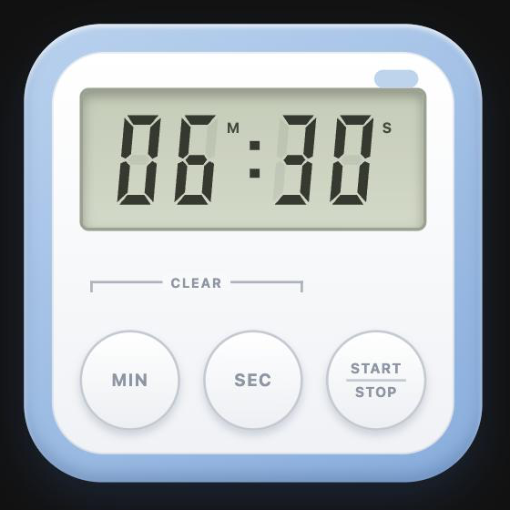

# Kitchen timer

A three-button kitchen timer with a seven-segment display. MIN and SEC set the time, START/STOP starts, pauses and resumes; it beeps and blinks when time is up. The countdown lives in a Timer helper, so every dashboard shows the same time.

- **Card:** [card.html](card.html). Paste the whole file into the card editor, then pick your entities in the form.
- **Needs:** A Timer helper
- **Rating:** yellow (contains a script)
- **Author:** [@davidrot](https://github.com/davidrot)
