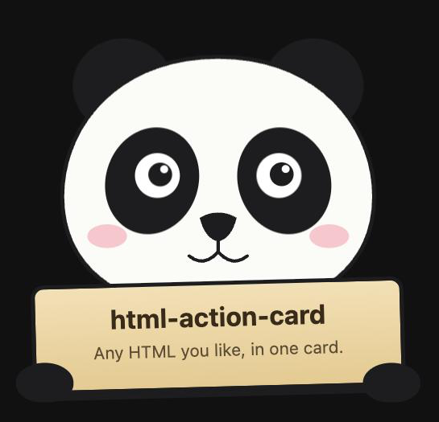

# Panda

A panda that holds a sign and follows your cursor. No background and no card frame, so it sits on any dashboard. Title and text of the sign are set in the card editor.

- **Card:** [card.html](card.html). Paste the whole file into the card editor, then pick your entities in the form.
- **Needs:** Nothing
- **Rating:** yellow (contains a script)
- **Author:** [@davidrot](https://github.com/davidrot)
