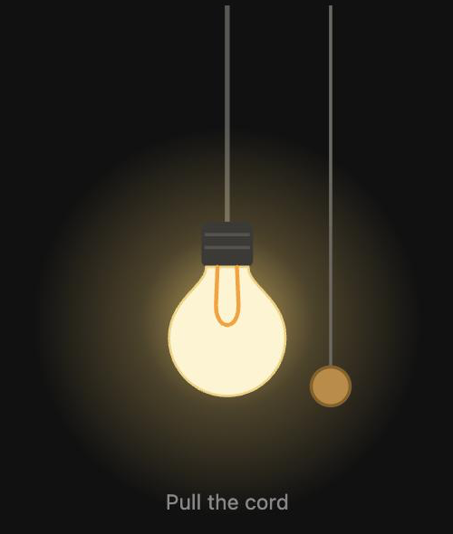

# Pull-cord lamp

A lamp you switch by pulling its cord. The cord springs back, the lamp swings, and the bulb follows the real light, also when it is switched elsewhere, glowing with its brightness.

- **Card:** [card.html](card.html). Paste the whole file into the card editor, then pick your entities in the form.
- **Needs:** A light
- **Rating:** yellow (contains a script)
- **Author:** [@davidrot](https://github.com/davidrot)
