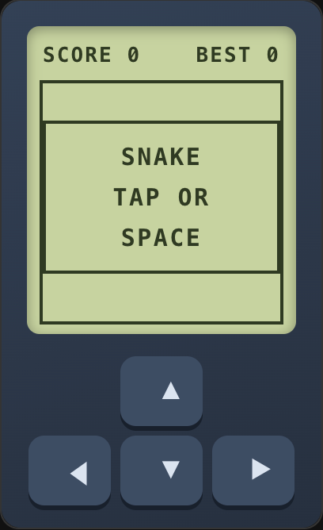

# Snake

A game in a dashboard card, with keyboard, swipe and button controls. The best score survives a reload; optionally it flashes a light on every point and shares the best score through a helper.

- **Card:** [card.html](card.html). Paste the whole file into the card editor, then pick your entities in the form.
- **Needs:** Nothing; optionally a light and an input_number helper
- **Rating:** yellow (contains a script)
- **Author:** [@davidrot](https://github.com/davidrot)
