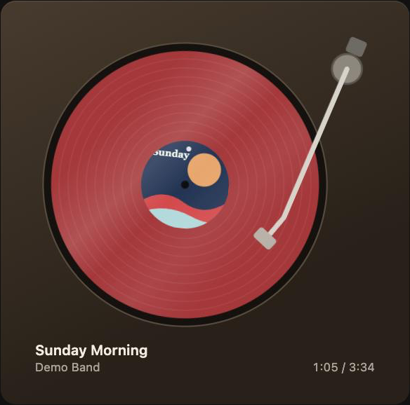

# Turntable

A media player as a record player. The cover spins on the label, the vinyl takes on the cover's colour, and the tone arm lowers onto the record while it plays and follows the song. Tap the record to play or pause, drag the arm to jump within the song.

- **Card:** [card.html](card.html). Paste the whole file into the card editor, then pick your entities in the form.
- **Needs:** A media player. To try it without one, add `media_player: - platform: demo` to `configuration.yaml`.
- **Rating:** yellow (contains a script)
- **Author:** [@davidrot](https://github.com/davidrot)
